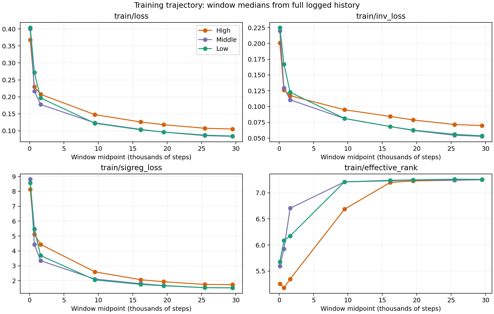
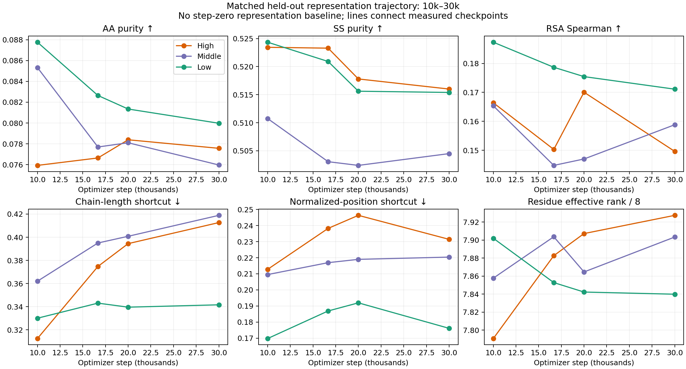

# LR trajectories and convergence through 30k

Training optimization improves strongly at first and slows near 30k. Held-out biological quality does not improve monotonically: lower training loss is not equivalent to a better representation. There is no saved/evaluated step-zero raw representation baseline, so biological improvement from random initialization cannot be quantified here.

## Training trajectory

Medians from full W&B history, retaining the latest row if a resumed step repeats.

| Run | Loss: steps 0–199 | 9k–10k | 19k–20k | 25k–26k | 29k–30k | Final-window vs 25k–26k |
|---|---:|---:|---:|---:|---:|---:|
| high | 0.36760 | 0.14762 | 0.11796 | 0.10754 | 0.10529 | -2.09% |
| middle | 0.39972 | 0.12346 | 0.09626 | 0.08588 | 0.08367 | -2.57% |
| low | 0.40352 | 0.12229 | 0.09638 | 0.08734 | 0.08465 | -3.08% |

The first window contains training batches after initialization, not an untrained held-out baseline. LR decays toward 1e-5 at 30k; the flattening is schedule-dependent, not proof of an optimum.

## Matched representation trajectory

Same ordered 15,000 residues, 5,224 proteins, 748,402-residue pool, raw encoder.

The table below contains every value plotted above. [Download all diagnostic metrics and checkpoint provenance as CSV](lr_all_trajectories_10k_to30k.csv).

| Run | Metric | 10k | 16,667 | 20k | 30k |
|---|---|---:|---:|---:|---:|
| high | AA purity ↑ | 0.07593 | 0.07665 | 0.07839 | 0.07757 |
| high | SS purity ↑ | 0.52344 | 0.52329 | 0.51780 | 0.51600 |
| high | RSA Spearman ↑ | 0.16642 | 0.15030 | 0.17005 | 0.14963 |
| high | Chain-length shortcut ↓ | 0.31254 | 0.37476 | 0.39447 | 0.41265 |
| high | Normalized-position shortcut ↓ | 0.21279 | 0.23826 | 0.24637 | 0.23144 |
| high | Residue effective rank / 8 | 7.79070 | 7.88270 | 7.90724 | 7.92748 |
| middle | AA purity ↑ | 0.08533 | 0.07770 | 0.07811 | 0.07597 |
| middle | SS purity ↑ | 0.51074 | 0.50305 | 0.50239 | 0.50449 |
| middle | RSA Spearman ↑ | 0.16535 | 0.14479 | 0.14701 | 0.15882 |
| middle | Chain-length shortcut ↓ | 0.36204 | 0.39502 | 0.40081 | 0.41889 |
| middle | Normalized-position shortcut ↓ | 0.20953 | 0.21694 | 0.21899 | 0.22039 |
| middle | Residue effective rank / 8 | 7.85774 | 7.90371 | 7.86463 | 7.90340 |
| low | AA purity ↑ | 0.08776 | 0.08265 | 0.08135 | 0.07998 |
| low | SS purity ↑ | 0.52435 | 0.52091 | 0.51561 | 0.51539 |
| low | RSA Spearman ↑ | 0.18732 | 0.17867 | 0.17544 | 0.17111 |
| low | Chain-length shortcut ↓ | 0.33009 | 0.34311 | 0.33963 | 0.34165 |
| low | Normalized-position shortcut ↓ | 0.16974 | 0.18688 | 0.19194 | 0.17608 |
| low | Residue effective rank / 8 | 7.90203 | 7.85282 | 7.84232 | 7.83992 |

## Paired protein bootstrap: 20k → 30k

5,000 paired protein bootstrap replicates, seed 42; delta = 30k minus 20k. Fixed 15,000-residue neighbour pool, query proteins resampled, ranks/residualization recomputed. Confidence intervals are conditional on this fixed pool and unadjusted for multiple comparisons. An interval containing zero is inconclusive, not proof of equivalence or convergence.

| Run | Metric | Delta | 95% interval | Fraction > 0 | Excludes zero |
|---|---|---:|---|---:|---|
| high | aa_purity_at_10_cross_protein | -0.000820 | [-0.002106, +0.000415] | 0.1048 | False |
| high | ss_purity_at_10_cross_protein | -0.001800 | [-0.004497, +0.000732] | 0.0796 | False |
| high | exact_index_at_10_cross_protein | +0.000060 | [-0.000357, +0.000471] | 0.6096 | False |
| high | nearest_neighbour_exact_index_all_neighbours | -0.002133 | [-0.004133, -0.000202] | 0.0114 | True |
| high | normalized_position_quintile_purity_at_10_cross_protein | -0.002527 | [-0.004929, -0.000153] | 0.0188 | True |
| high | same_protein_fraction_at_10 | +0.004893 | [+0.003868, +0.005918] | 1.0000 | True |
| high | rsa_knn10_spearman | -0.020421 | [-0.034517, -0.006266] | 0.0034 | True |
| high | log_chain_length_knn10_spearman | +0.018183 | [+0.007377, +0.029299] | 0.9992 | True |
| high | raw_index_knn10_spearman | -0.005279 | [-0.018080, +0.007398] | 0.2098 | False |
| high | normalized_position_knn10_spearman | -0.014928 | [-0.028641, -0.001087] | 0.0166 | True |
| high | raw_index_within_16aa_length_bin_knn10_spearman | -0.002774 | [-0.009237, +0.003781] | 0.2042 | False |
| high | raw_index_partial_length_spearman | -0.012028 | [-0.025683, +0.001325] | 0.0390 | False |
| middle | aa_purity_at_10_cross_protein | -0.002133 | [-0.003410, -0.000856] | 0.0004 | True |
| middle | ss_purity_at_10_cross_protein | +0.002100 | [-0.000530, +0.004713] | 0.9450 | False |
| middle | exact_index_at_10_cross_protein | +0.000080 | [-0.000327, +0.000484] | 0.6538 | False |
| middle | nearest_neighbour_exact_index_all_neighbours | -0.001133 | [-0.003045, +0.000797] | 0.1208 | False |
| middle | normalized_position_quintile_purity_at_10_cross_protein | +0.000633 | [-0.001897, +0.003051] | 0.6942 | False |
| middle | same_protein_fraction_at_10 | +0.006820 | [+0.005718, +0.007938] | 1.0000 | True |
| middle | rsa_knn10_spearman | +0.011818 | [-0.002728, +0.026110] | 0.9484 | False |
| middle | log_chain_length_knn10_spearman | +0.018077 | [+0.007134, +0.029103] | 0.9992 | True |
| middle | raw_index_knn10_spearman | -0.003061 | [-0.016906, +0.010582] | 0.3386 | False |
| middle | normalized_position_knn10_spearman | +0.001402 | [-0.013112, +0.015967] | 0.5740 | False |
| middle | raw_index_within_16aa_length_bin_knn10_spearman | -0.001754 | [-0.009045, +0.005346] | 0.3152 | False |
| middle | raw_index_partial_length_spearman | -0.006320 | [-0.020718, +0.007924] | 0.1996 | False |
| low | aa_purity_at_10_cross_protein | -0.001367 | [-0.002705, +0.000026] | 0.0270 | False |
| low | ss_purity_at_10_cross_protein | -0.000220 | [-0.002911, +0.002531] | 0.4466 | False |
| low | exact_index_at_10_cross_protein | -0.000660 | [-0.001076, -0.000267] | 0.0000 | True |
| low | nearest_neighbour_exact_index_all_neighbours | +0.000133 | [-0.001807, +0.002011] | 0.5356 | False |
| low | normalized_position_quintile_purity_at_10_cross_protein | -0.001840 | [-0.004226, +0.000542] | 0.0678 | False |
| low | same_protein_fraction_at_10 | +0.002027 | [+0.001021, +0.003020] | 1.0000 | True |
| low | rsa_knn10_spearman | -0.004337 | [-0.019150, +0.010124] | 0.2822 | False |
| low | log_chain_length_knn10_spearman | +0.002029 | [-0.009947, +0.013695] | 0.6314 | False |
| low | raw_index_knn10_spearman | -0.008844 | [-0.022790, +0.004941] | 0.1050 | False |
| low | normalized_position_knn10_spearman | -0.015855 | [-0.030395, -0.001148] | 0.0180 | True |
| low | raw_index_within_16aa_length_bin_knn10_spearman | -0.000674 | [-0.008203, +0.006798] | 0.4312 | False |
| low | raw_index_partial_length_spearman | -0.013074 | [-0.027115, +0.000853] | 0.0336 | False |

## What this establishes

The measured trajectory and uncertainty can establish a practical plateau, mixed changes, or degradation on these probes. They cannot prove global convergence or downstream task optimality. Healthy effective rank only rules against gross collapse. A continuation at a defined LR would test whether the end-of-schedule plateau is persistent.

## Assessment by run

- **High LR:** no clear late AA/SS improvement. From 20k to 30k, RSA falls by 0.02042 (95% paired-protein interval −0.03452 to −0.00627), and chain-length correlation rises by 0.01818 (0.00738 to 0.02930). Normalized-position correlation improves. This is a mixed-to-worse biological trajectory, not evidence of continued broad improvement.
- **Middle LR:** AA declines from 20k to 30k by 0.00213 (−0.00341 to −0.00086). SS/RSA changes are inconclusive, while chain-length correlation increases by 0.01808 (0.00713 to 0.02910). Its 30k AA/SS/RSA point estimates are all below 10k. The late trajectory is mixed rather than uniformly improving.
- **Low LR:** 20k-to-30k AA, SS, and RSA intervals include zero, while normalized-position correlation falls by 0.01585 (−0.03040 to −0.00115). This supports a practical biological plateau on these probes, with reduced positional shortcut signal, not a proof of equivalence or global convergence.

All three still reduce the training objective late in training, but only by about 2–3% from the 25k–26k window to the final 1,000 steps. All retain healthy representation rank. There is no evidence that simply training longer consistently improves biological signal, and 30k is not automatically the best representation checkpoint. Low LR at 10k remains a strong candidate under AA/SS/RSA criteria, although its comparison to later checkpoints also involves shortcut tradeoffs.

## Supporting data

- [Full training-window statistics](lr_training_trajectory.json)
- [High LR: 20k-to-30k bootstrap](lr_high_raw20k_to30k_bootstrap.csv)
- [Middle LR: 20k-to-30k bootstrap](lr_middle_raw20k_to30k_bootstrap.csv)
- [Low LR: 20k-to-30k bootstrap](lr_low_raw20k_to30k_bootstrap.csv)

The bootstrap CSVs in this report package label the original point estimates as `step_20000` and `step_30000`; every delta is later minus earlier.
