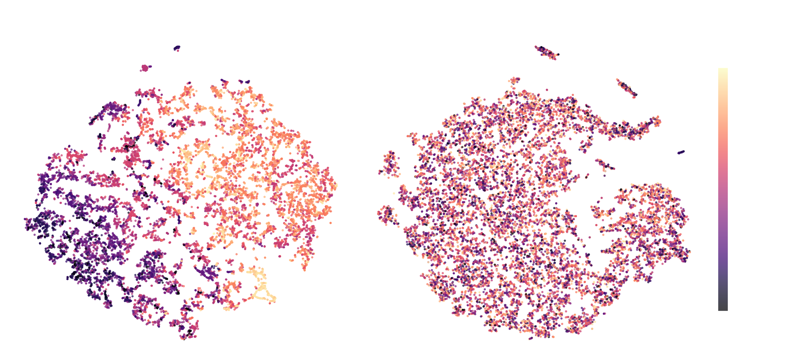
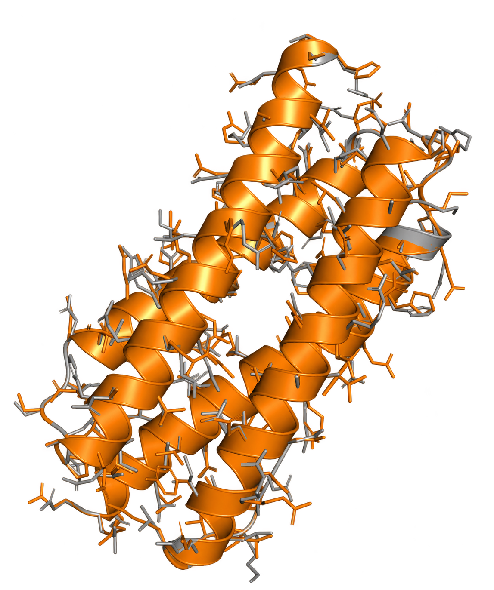
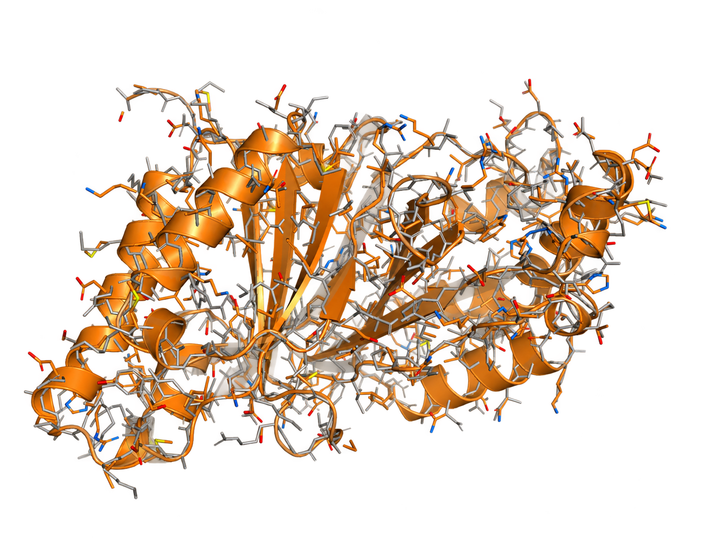

# JEPA for all-atom protein representation learning

This repository contains the training code, evaluation pipelines, and archived
results for _All-Atom Protein JEPAs: Learning and Diagnosing Predictive Latent Representations_ (GEM Workshop at NeurIPS 2026). It
extends [NVIDIA BioNeMo's La-Proteina](https://github.com/NVIDIA-BioNeMo/la-proteina)
with autoencoder controls, JEPA and JEPA+SIGReg experiments, canonical LeJEPA,
StructTokenBench integration, representation diagnostics, and reconstruction
evaluation.


## How to run

The complete train-to-results workflow is in
[`docs/REPRODUCIBILITY.md`](docs/REPRODUCIBILITY.md). It covers:

- environment and data setup;
- which branch trains each model family;
- training and resume commands;
- downloading the evaluated checkpoints from Hugging Face;
- running the locked StructTokenBench protocol;
- linear probes, k-NN purity, fold retrieval, t-SNE, and reconstruction;
- where checkpoints, logs, numerical results, and manuscript figures live.

For an existing environment, the shortest evaluation setup is:

```bash
git clone https://github.com/aishahodzic/msc-thesis.git
cd msc-thesis
hf auth login
python script_utils/stage_thesis_checkpoints.py --group core

cd StructTokenBench
bash src/script/run_eval.sh \
  --protocol=upstream-l600-v1 \
  --checkpoint=100k \
  --experiment=jepa-rand-mask-70 \
  --tasks=all
```

The checkpoint staging command downloads each file once into the Hugging Face
cache, verifies it against the archive manifest, and creates the compatibility
paths used by the evaluation code.

## Reproducibility archives

- Private model archive:
  [`msc-thesis-org/ckpts`](https://huggingface.co/datasets/msc-thesis-org/ckpts)
- Checkpoint inventory and SHA-256 checksums (file-integrity verification,
  unrelated to the StructTokenBench L600 protocol):
  [`manifest.csv`](https://huggingface.co/datasets/msc-thesis-org/ckpts/blob/main/manifest.csv)
- Selected reconstruction examples:
  [`pymol_reconstruction/`](https://huggingface.co/datasets/msc-thesis-org/ckpts/tree/main/pymol_reconstruction)
- Processed training data:
  [`msc-thesis-org/pdb-processed`](https://huggingface.co/datasets/msc-thesis-org/pdb-processed)

The Hugging Face archives above are private; access is available on request.

## Repository map

| Path | Purpose |
|---|---|
| `proteinfoundation/` | Models, training entry points, datasets, and checkpoint utilities |
| `configs/` | Hydra training, model, dataset, inference, and evaluation configuration |
| `jobs/` | Exact Slurm launchers used for training, evaluation, and analysis |
| `StructTokenBench/` | Integrated downstream benchmark and frozen-encoder wrapper |
| `StructTokenBench/struct_token_bench_logs/upstream-l600-v1-full/` | Saved L600 task summaries and run manifests |
| `Evaluation/` | Linear probes, k-NN purity, retrieval, latent visualisation, diagnostics, and reconstruction |
| `Evaluation/**/results/` | Compact numerical results and run manifests retained in Git |
| `images/` | Curated thesis and paper figures, grouped by method, latent space, reconstruction, and evaluation |
| `thesis-latex/` | Thesis source and build artifacts |
| `iclr2027/` | Paper source and build artifacts |
| `datasetcard/`, `modelcard/` | Dataset and model documentation |

Large checkpoints, embedding caches, decoder intermediates, and bulk generated
structures are intentionally excluded from Git. The retained checkpoints and
ten qualitative reconstruction examples are in the private Hugging Face
archive above.

## Model families and branches

| Family | Source branch | Main entry point |
|---|---|---|
| C-alpha-conditioned AE | `ca-cond-baseline` | `proteinfoundation/partial_autoencoder/train.py` |
| Fully latent AE | `fully-latent` | `proteinfoundation/partial_autoencoder/train.py` |
| JEPA and JEPA interventions | `jepa-latent` | `proteinfoundation/jepa/train.py` |
| Historical JEPA+SIGReg runs | `le-jepa` | `proteinfoundation/jepa/train.py` |
| Canonical LeJEPA | `canonical-lejepa` | `proteinfoundation/jepa/train_canonical_lejepa.py` |
| Evaluation and archived results | `main` | `StructTokenBench/` and `Evaluation/` |

Use Git worktrees when reproducing training so that `main` remains available
for evaluation and result inspection. Exact commands are provided in the
reproducibility guide.

## Citation and upstream project

This work builds on the original
[La-Proteina repository](https://github.com/NVIDIA-BioNeMo/la-proteina) and the
[StructTokenBench project](https://github.com/KatarinaYuan/StructTokenBench).
See the thesis and paper sources for the complete bibliography and experimental
methodology.

La-Proteina source code is released under Apache 2.0 and its model weights under the NVIDIA Open Model License. Files under `proteinfoundation` are modified from the original source in this work.

## Selected results

<p align="center">
  
</p>

<p align="center"><sub>Residue embeddings coloured by protein chain length: uncropped LeJEPA (left) and cropped LeJEPA (right).</sub></p>

<p align="center">
  
  
</p>

<p align="center"><sub>Whole-protein overlays of native structures (grey) and postprocessed JEPA reconstructions (orange): 4ETR chain A (left) and 5A13 chain G (right).</sub></p>
